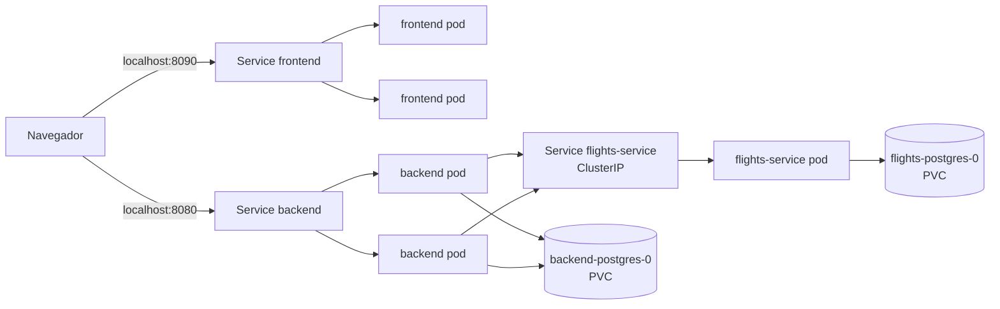

# Despliegue en Kubernetes

La carpeta `k8s/` despliega la aplicación (2 bases, flights-service, backend y frontend) en un cluster de Kubernetes. A diferencia de Compose, el cluster **mantiene** el estado pedido: si un pod se cae o se borra, lo vuelve a crear; si un pod no pasa su probe, deja de recibir tráfico o se reinicia.

El workflow [Kubernetes CI](../.github/workflows/kubernetes.yml) levanta un cluster [kind](https://kind.sigs.k8s.io/) en GitHub Actions, aplica estos manifiestos con las imágenes del commit, hace un smoke test y prueba la autorecuperación borrando un pod del backend.

## Objetos

| Archivo | Objetos | Para qué |
|---------|---------|----------|
| `namespace.yaml` | `Namespace` `ctv` | Agrupa todo; `kubectl delete namespace ctv` borra la aplicación |
| `config.yaml` | 4 `ConfigMap` | Configuración no sensible: perfil de Spring, seed, conexión a las bases, CORS y un Logback solo de consola |
| `secret-demo.yaml` | `Secret` `ctv-secrets` | Contraseñas de las bases y `JWT_SECRET`. **Valores de demo, públicos en el repo** |
| `backend-postgres.yaml`, `flights-postgres.yaml` | `StatefulSet` + `PersistentVolumeClaim` + `Service` headless | Una base por servicio, con datos persistentes |
| `flights-service.yaml` | `Deployment` (1 réplica) + `Service` `ClusterIP` | API de vuelos, solo accesible dentro del cluster |
| `backend.yaml` | `Deployment` (2 réplicas) + `Service` `LoadBalancer` | API de CTV, expuesta en `localhost:8080` |
| `frontend.yaml` | `Deployment` (2 réplicas) + `Service` `LoadBalancer` | SPA en nginx, expuesta en `localhost:8090` |
| `kustomization.yaml` | — | Lista los archivos, fija el namespace y los tags de las imágenes (`images:`) |
| `kind-config.yaml` | — | Cluster kind de un nodo con los puertos 8080 y 8090 del host |
| `docker-bake.hcl` | — | Build de las 3 imágenes para el cluster (lo usa la CI) |



El navegador habla con los dos Services porque el frontend es una SPA: el JavaScript corre en el navegador y llama al backend en `http://localhost:8080`.

### Por qué cada objeto

- **Deployment** para backend, flights-service y frontend: no guardan estado, así que cualquier pod es intercambiable. El Deployment mantiene la cantidad de réplicas pedida y hace actualizaciones graduales (`maxUnavailable: 0`: nunca baja de las réplicas pedidas durante un cambio de versión).
- **StatefulSet** para PostgreSQL: el pod tiene nombre fijo (`backend-postgres-0`) y su propio `PersistentVolumeClaim`. Si el pod se borra, el nuevo se engancha al mismo volumen y los datos siguen ahí. Es el equivalente de los volúmenes nombrados de Compose.
- **Service**: nombre DNS estable delante de pods que cambian de IP. El backend llega a `http://flights-service:8081` y a `backend-postgres:5432` igual que en Compose. Las bases usan un Service *headless* (sin IP virtual, resuelve directo al pod). `flights-service` es `ClusterIP`: no se puede llegar desde fuera del cluster, como en la VM. Backend y frontend son `LoadBalancer`: Docker Desktop los publica en `localhost`; en kind la IP externa queda `<pending>` y se llega por el `nodePort` fijo (30080 y 30090) que `kind-config.yaml` mapea a 8080 y 8090.
- **ConfigMap y Secret**: la configuración sale de la imagen, como las variables de entorno de Compose. Lo sensible va en el Secret, que se puede crear aparte sin versionarlo.
- **Probes** (con los grupos de salud de Spring Boot Actuator):
  - `startupProbe` (`/actuator/health/liveness`): le da a la JVM hasta 3 minutos para arrancar antes de que actúe la liveness.
  - `livenessProbe` (`/actuator/health/liveness`): si falla 3 veces, Kubernetes reinicia el contenedor.
  - `readinessProbe` (`/actuator/health/readiness`, incluye la base): mientras falla, el pod no recibe tráfico del Service.
  - En el frontend, ambas contra `/`; en PostgreSQL, `pg_isready`.
- **initContainer `wait-for-db`**: backend y flights-service esperan a que su base responda, como `depends_on: condition: service_healthy` en Compose.
- **Réplicas**: 2 de backend y 2 de frontend. Si una se cae, la otra sigue atendiendo mientras el Deployment crea el reemplazo. La seed es segura con varias réplicas porque toma un lock en la base.
- **Recursos y seguridad**: cada contenedor tiene `requests`/`limits` chicos (la JVM usa hasta el 75 % del límite con `MaxRAMPercentage`). Todos corren sin root con el usuario de su imagen (10001 en backend y flights-service, 101 en nginx, 999 en PostgreSQL), sin escalar privilegios, sin capabilities y, salvo PostgreSQL, con el sistema de archivos de solo lectura (`/tmp` es un `emptyDir`).

### Imágenes

`kustomization.yaml` fija los tags; los manifiestos no los repiten.

- **backend y flights-service**: `ghcr.io/acostaf12/ctv-backend:latest` y `ctv-flights-service:latest`, publicadas desde `main`. No hace falta compilar nada para la demo.
- **frontend**: la imagen publicada tiene horneada la URL de la VM (`VITE_API_BASE_URL=http://<VM_HOST>:8080`), así que no sirve en local. El cluster usa `ctv-frontend:local`, construida con `VITE_API_BASE_URL=http://localhost:8080`.
- **CI**: construye las 3 imágenes del commit con `k8s/docker-bake.hcl` (vía `scripts/ci-build-images.sh`, con caché y reintentos), las carga con `kind load docker-image` y las aplica con un overlay de Kustomize que solo cambia `images:`.

Para probar otra versión sin editar archivos:

```bash
cd k8s
kustomize edit set image ghcr.io/acostaf12/ctv-backend=ghcr.io/acostaf12/ctv-backend:<sha>
```

### Monitoreo

Prometheus, Grafana, Zipkin y ELK quedan en Compose. En el cluster, `TRACING_SAMPLING_PROBABILITY=0` apaga las trazas y `LOGGING_CONFIG` apunta a un Logback montado desde el ConfigMap `ctv-logback` que solo escribe a consola (sin el appender de Logstash). Los logs se ven con `kubectl logs`.

## Correrlo en local con kind

Requisitos: Docker Desktop, [`kind`](https://kind.sigs.k8s.io/docs/user/quick-start/#installation) y `kubectl` (viene con Docker Desktop). El cluster usa unos 2,2 GB de RAM. Apagar antes Compose, que usa los mismos puertos (`docker compose down`).

Desde la raíz del repositorio:

```bash
# 1. Cluster de un nodo con los puertos 8080 y 8090 del host
kind create cluster --config k8s/kind-config.yaml

# 2. Imagen del frontend apuntando a localhost:8080, cargada en el nodo
docker build -t ctv-frontend:local --build-arg VITE_API_BASE_URL=http://localhost:8080 frontend
kind load docker-image --name ctv ctv-frontend:local

# 3. Aplicar todo (backend y flights-service se descargan de GHCR)
kubectl apply -k k8s/

# 4. Esperar a que esté listo (la primera vez, 2 a 4 minutos)
kubectl -n ctv rollout status deployment/backend --timeout=300s
kubectl -n ctv get pods
```

| Servicio | URL |
|----------|-----|
| Frontend | http://localhost:8090 |
| Backend | http://localhost:8080 |
| Swagger | http://localhost:8080/swagger-ui/index.html |

Los usuarios de demo son los mismos que en Compose (`buyer` / `buyer123`, etc.).

Apagar: `kind delete cluster --name ctv` (borra también los datos).

> **Si `kind create cluster` falla con "kubelet is configured to not run on a host using cgroup v1"**: Docker Desktop está usando cgroup v1 (WSL viejo) y las versiones nuevas de Kubernetes ya no lo aceptan. Lo mejor es actualizar WSL (`wsl --update`) y Docker Desktop. Como alternativa, agregar al nodo de `kind-config.yaml`:
>
> ```yaml
>     kubeadmConfigPatches:
>       - |
>         kind: KubeletConfiguration
>         failCgroupV1: false
> ```

## Correrlo con el Kubernetes de Docker Desktop

1. Settings → Kubernetes → Enable Kubernetes (modo *kubeadm*) → Apply. Esperar a que el ícono de Kubernetes quede en verde.
2. `kubectl config use-context docker-desktop`
3. Construir el frontend (`docker build -t ctv-frontend:local ...`, igual que arriba). En modo *kubeadm* el cluster ve las imágenes de Docker Desktop, así que no hace falta `kind load`. Si se eligió el modo *kind* de Docker Desktop, cargarla con `kind load docker-image` o publicarla en un registry.
4. `kubectl apply -k k8s/`

Docker Desktop publica los Services `LoadBalancer` en `localhost`, así que las URLs son las mismas (8090 y 8080). Para borrar todo: `kubectl delete namespace ctv`.

## Mostrar la autorecuperación y el escalado

En una terminal, mirar los pods en vivo:

```bash
kubectl -n ctv get pods -w
```

En otra:

```bash
# Autorecuperación: borrar un pod del backend. El Deployment crea otro enseguida
# y la otra réplica sigue atendiendo mientras tanto.
kubectl -n ctv get pods -l app.kubernetes.io/name=backend   # elegir uno
kubectl -n ctv delete pod <nombre-de-un-pod-backend> --wait=false
curl -s -o /dev/null -w '%{http_code}\n' -X POST http://localhost:8080/auth/login \
  -H 'Content-Type: application/json' -d '{"username":"buyer","password":"buyer123"}'   # 200

# Los datos sobreviven: borrar el pod de la base y volver a consultar
kubectl -n ctv delete pod backend-postgres-0

# Escalado manual
kubectl -n ctv scale deployment/backend --replicas=3
kubectl -n ctv get pods -l app.kubernetes.io/name=backend
kubectl -n ctv scale deployment/backend --replicas=2

# Actualización gradual sin cortar el servicio
kubectl -n ctv rollout restart deployment/frontend
kubectl -n ctv rollout status deployment/frontend
```

Otros comandos útiles:

```bash
kubectl -n ctv get all,pvc
kubectl -n ctv logs -f deployment/backend          # logs de una réplica
kubectl -n ctv describe pod <pod>                   # eventos y estado de las probes
```

## Secret real

`secret-demo.yaml` tiene valores públicos y solo sirve para la demo. Para un cluster real, sacarlo de `resources` en `kustomization.yaml` y crear el Secret antes de aplicar:

```bash
kubectl create namespace ctv
kubectl -n ctv create secret generic ctv-secrets \
  --from-literal=BACKEND_DB_PASSWORD="$(openssl rand -base64 24)" \
  --from-literal=FLIGHTS_DB_PASSWORD="$(openssl rand -base64 24)" \
  --from-literal=JWT_SECRET="$(openssl rand -base64 48)"
kubectl apply -k k8s/
```

`JWT_SECRET` necesita 32 bytes o más. PostgreSQL toma la contraseña solo al crear el volumen: para cambiarla después hay que cambiarla también dentro de la base.

## Comparación con Docker Compose

| | Docker Compose | Kubernetes |
|---|---|---|
| Unidad | Contenedor | Pod (uno o más contenedores) |
| Réplicas | Una por servicio | Las que pida el Deployment; se reponen solas |
| Si un contenedor muere | Queda caído (salvo `restart:`) | Se recrea y vuelve a entrar al Service cuando pasa la readiness |
| Dependencias | `depends_on` con healthcheck | initContainers y probes |
| Red interna | Redes de Compose | Services y DNS del cluster |
| Configuración | `environment` y `.env` | ConfigMap y Secret |
| Datos | Volúmenes nombrados | PersistentVolumeClaim |
| Actualizar versión | `docker compose up` recrea | Rolling update sin cortar el servicio |

## Limitaciones

- El monitoreo (Prometheus, Grafana, Zipkin, ELK) sigue en Compose; en el cluster solo hay logs por consola.
- La VM de Azure sigue desplegando con Compose; Kubernetes se prueba en kind (CI y local), no en la nube.
- No hay `HorizontalPodAutoscaler`: necesita metrics-server y se superpondría con la demo de `kubectl scale`. El escalado es manual.
- No hay `NetworkPolicy`: dentro del cluster cualquier pod puede hablar con cualquier Service (Compose separa redes). flights-service y las bases igual quedan inaccesibles desde fuera.
- PostgreSQL corre con una sola réplica: los datos persisten, pero mientras el pod se recrea la base no responde.
- El frontend necesita una imagen propia por URL del backend, porque Vite la hornea en el build.
